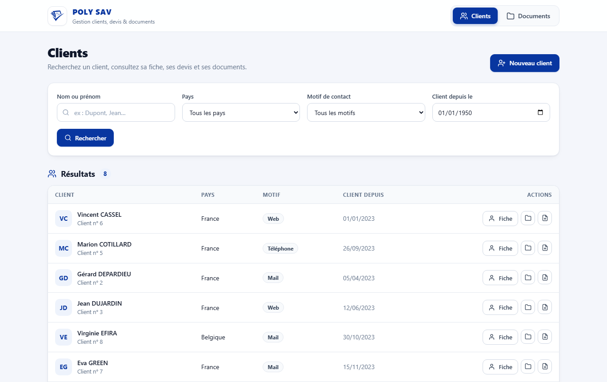
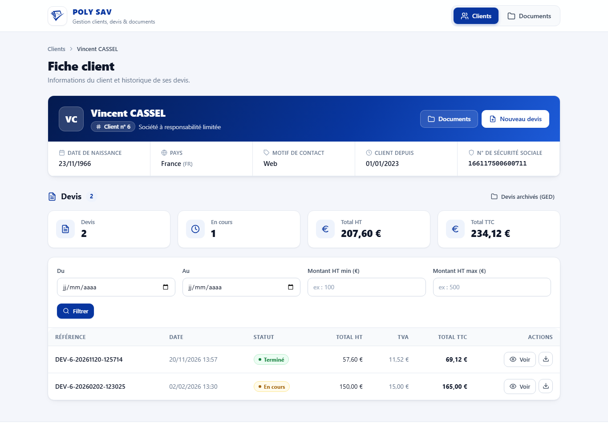
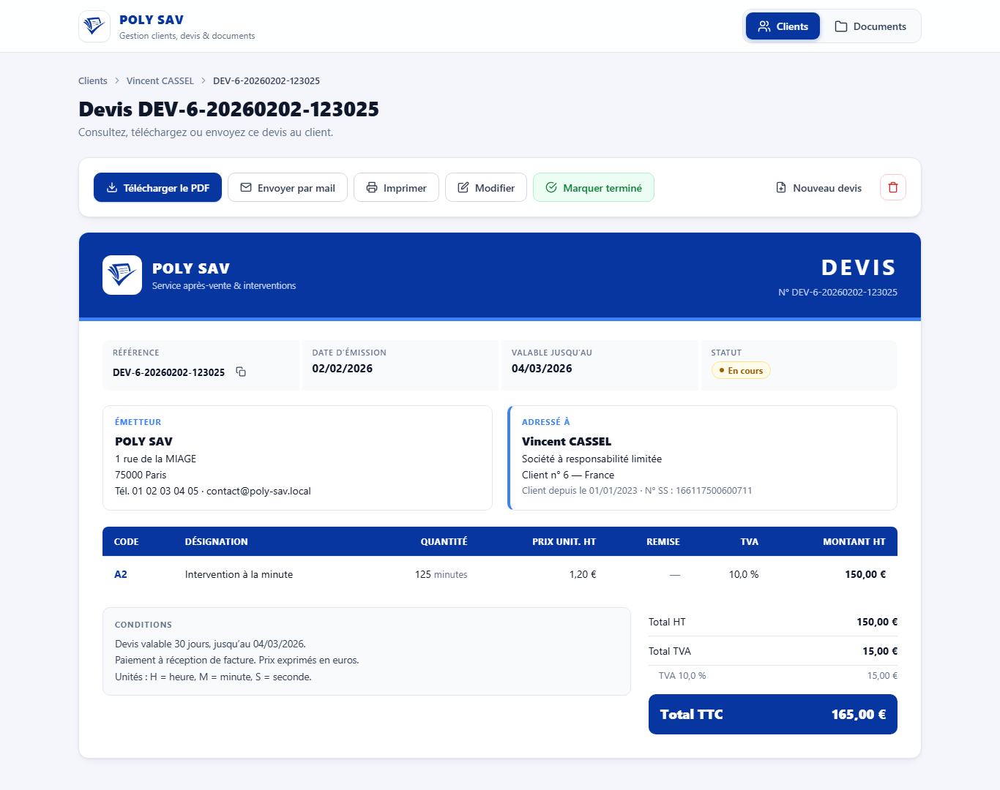
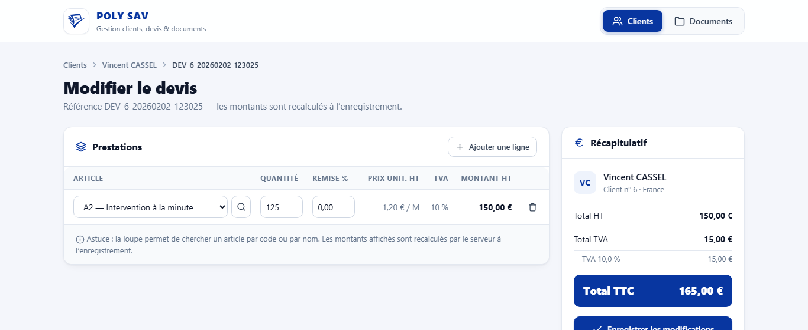
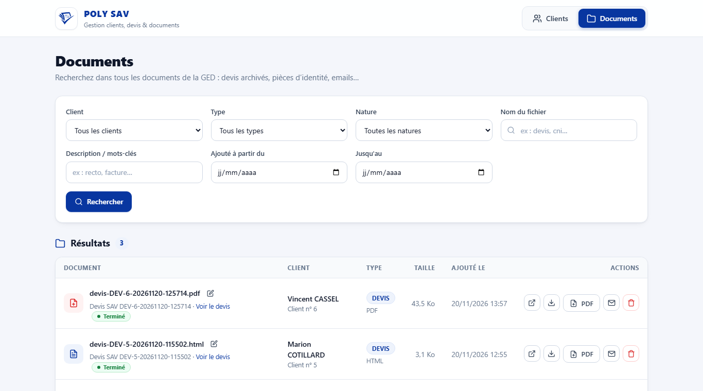
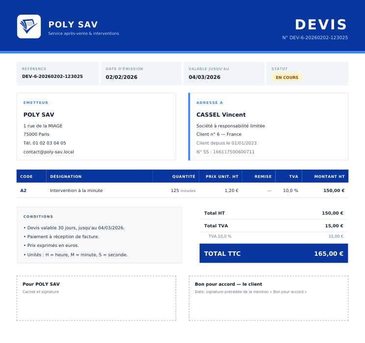

<p align="center">
  
</p>

<h1 align="center">POLY SAV</h1>

<p align="center">
  Application web de gestion d'un service après-vente : <strong>clients</strong>, <strong>devis</strong> et <strong>gestion électronique des documents (GED)</strong>.<br>
  PHP 8 · MySQL / MariaDB · PDF avec Dompdf · Emails avec PHPMailer<br>
  <sub>Par <strong>Owen Gicquel</strong> et <strong>Kahina Ait Kaci Arab</strong></sub>
</p>

<p align="center">
  
</p>

---

## Sommaire

- [Fonctionnalités](#fonctionnalités)
- [Captures d'écran](#captures-décran)
- [Prérequis](#prérequis)
- [Installation et lancement](#installation-et-lancement)
- [Configuration de l'envoi de mails](#configuration-de-lenvoi-de-mails)
- [Structure du projet](#structure-du-projet)
- [Base de données](#base-de-données)
- [Sécurité](#sécurité)
- [Dépannage](#dépannage)
- [Auteurs](#auteurs)

## Fonctionnalités

### Clients
- Recherche par nom ou prénom, pays, motif de contact et date d'entrée.
- Création d'un client (numéro attribué automatiquement, contrôles de saisie côté serveur).
- Fiche client : identité, informations, statistiques et historique des devis, filtrable par date et par montant HT.

### Devis
- Saisie multi-lignes : article, quantité, remise en %. Une loupe permet de chercher un article par code ou par nom.
- Calcul en direct du total HT, de la TVA **par taux** et du TTC. Les montants sont **recalculés côté serveur** à l'enregistrement.
- Statut **En cours** (modifiable) ou **Terminé** (verrouillé), et suppression.
- **PDF** mis en page avec le logo : téléchargement, impression, et **envoi par mail en pièce jointe PDF**.
- Chaque devis est archivé automatiquement dans la GED au format PDF, et cette copie est mise à jour à chaque modification.

### GED (documents)
- Upload par glisser-déposer : PDF, PNG, JPEG, GIF ou texte, 20 Mo maximum.
- Indexation par type, nature et mots-clés.
- **Anti-doublon** par empreinte SHA-256 : un même fichier ne peut pas être stocké deux fois pour un client.
- Ouvrir, télécharger l'original, **télécharger en PDF**, **envoyer par mail en PDF** (conversion automatique), renommer, supprimer.
- Recherche globale dans tous les documents (client, type, nature, nom, mots-clés, dates).

### Interface
- Design homogène aux couleurs du logo, adapté au mobile, et impression du devis optimisée.

## Captures d'écran

| Fiche client | Devis |
|---|---|
|  |  |

| Saisie d'un devis | Recherche de documents |
|---|---|
|  |  |

<p align="center">
  <strong>Devis généré en PDF</strong><br>
  
</p>

## Prérequis

- **WAMP** (Windows), **MAMP** (macOS) ou **XAMPP**, ou à défaut PHP et MySQL/MariaDB installés séparément.
- **PHP 8.1 ou plus récent** avec les extensions `pdo_mysql`, `mbstring`, `fileinfo`, `gd`, `dom` et `openssl` (toutes actives par défaut dans WAMP et MAMP).
- **MySQL 8** ou **MariaDB 10+**.

Les bibliothèques (Dompdf, PHPMailer) sont fournies dans le dossier `vendor/` : **Composer n'est pas nécessaire**.

## Installation et lancement

### 1. Récupérer le projet

```bash
git clone <url-du-depot> PROGWEB
```

### 2. Démarrer la base de données

Lancez WAMP, MAMP ou XAMPP et attendez que le serveur MySQL soit démarré (icône verte dans WAMP).

> **La base se crée toute seule.** Au premier affichage d'une page, l'application :
> - cherche le serveur MySQL sur les ports **3306, 3307, 3308 et 8889** ;
> - crée l'utilisateur `user1` ;
> - crée la base `poly_php` à partir de [`base_poly.sql`](base_poly.sql), avec ses données de test.
>
> Pour l'installer à la main, exécutez `base_poly.sql` dans phpMyAdmin.

### 3. Lancer le site

**Option A — serveur intégré de PHP (le plus simple)**

```powershell
cd chemin\vers\PROGWEB
# Windows avec WAMP :
& "C:\wamp64\bin\php\php8.3.28\php.exe" -S localhost:8000
# macOS / Linux :
php -S localhost:8000
```

Ouvrez ensuite **http://localhost:8000**.

**Option B — via WAMP, MAMP ou XAMPP**

Placez le dossier dans `C:\wamp64\www\` (WAMP), `htdocs/` (MAMP ou XAMPP), puis ouvrez `http://localhost/PROGWEB/`.

## Configuration de l'envoi de mails

Les identifiants SMTP sont secrets : ils **ne sont pas versionnés**.

1. Copiez `config.local.example.php` en **`config.local.php`**.
2. Renseignez `SMTP_USER`, `SMTP_PASS` et `SMTP_FROM_EMAIL`.
   Avec Gmail, il faut activer la validation en deux étapes, puis créer un *mot de passe d'application* (Compte Google › Sécurité › Mots de passe des applications).

Sans ce fichier, tout fonctionne sauf l'envoi de mails, qui affiche un message explicatif.
Le même fichier permet aussi, si besoin, de forcer le port MySQL (`DB_PORT`) ou les identifiants administrateur.

## Structure du projet

```
PROGWEB/
├── index.php                  # Redirige vers la liste des clients
├── recherche_client.php       # Liste et recherche des clients, création d'un client
├── client_action.php          # Traitement de la création d'un client
├── fiche_client.php           # Fiche client et historique des devis
├── devis_client.php           # Saisie, modification, consultation, PDF et mail d'un devis
├── documents_client.php       # GED d'un client (upload et liste)
├── recherche_documents.php    # Recherche globale dans la GED
├── document_action.php        # Ouvrir, télécharger, PDF, mail, renommer, supprimer un document
├── ressources_communes.php    # Connexion BDD, accès aux données, GED, PDF, mails
├── partials/
│   ├── layout.php             # Gabarit commun (en-tête, pied de page, icônes, fenêtres)
│   └── doc_table.php          # Tableau de documents réutilisable
├── assets/
│   ├── app.css                # Feuille de style unique
│   └── img/                   # Logo et favicon
├── base_poly.sql              # Création de la base et données de test
├── config.local.example.php   # Modèle de configuration locale (secrets)
├── _storage/                  # Fichiers de la GED (non versionnés, accès web interdit)
├── vendor/                    # Dépendances (Dompdf, PHPMailer)
└── docs/screenshots/          # Captures d'écran du README
```

## Base de données

| Table | Contenu |
|---|---|
| `clients` | Clients (avec liens vers `pays`, `motifs` et `formes_juridiques`) |
| `articles` | Prestations vendues (unité, prix forfaitaire HT, taux de TVA via `tva`) |
| `devis` | En-tête du devis : référence, date, statut, totaux, coordonnées de la société |
| `devis_lignes` | Lignes du devis (quantité, prix, remise, TVA, montant HT) |
| `devis_tva` | Détail de la TVA par taux pour chaque devis |
| `ged_documents` | Index de la GED : type, nature, mots-clés, chemin, MIME, taille, SHA-256 |

Les lignes et le détail de TVA sont supprimés avec leur devis (`ON DELETE CASCADE`). L'anti-doublon repose sur une contrainte d'unicité `(client_code, sha256)`.

## Sécurité

- **Requêtes préparées PDO** partout : protection contre les injections SQL.
- **Échappement HTML** de toutes les données affichées : protection contre les attaques XSS.
- **Montants recalculés côté serveur** : on ne fait jamais confiance aux calculs faits par le navigateur.
- Uploads contrôlés : type MIME réel, taille, empreinte SHA-256, nom de fichier nettoyé, et chemin vérifié contre les attaques par *path traversal*.
- `_storage/` est inaccessible depuis le web (`.htaccess`) : les fichiers ne sont servis que par `document_action.php`.
- Les actions qui modifient des données (suppression, statut, mail) passent uniquement en **POST**.
- Les secrets (SMTP) sont dans `config.local.php`, exclu de Git.

## Dépannage

| Problème | Solution |
|---|---|
| « Base de données indisponible » | Vérifiez que MySQL est démarré. Si votre compte `root` a un mot de passe, renseignez `LOCAL_ROOT_USER` et `LOCAL_ROOT_PASS` dans `config.local.php`, ou exécutez `base_poly.sql` dans phpMyAdmin. |
| « Envoi de mail non configuré » | Créez `config.local.php` (voir [Configuration de l'envoi de mails](#configuration-de-lenvoi-de-mails)). |
| Erreur Gmail lors de l'envoi | Utilisez un *mot de passe d'application* et non le mot de passe du compte. |
| « Fichier trop volumineux » | Augmentez `upload_max_filesize` et `post_max_size` dans `php.ini`. |

## Auteurs

- **Owen Gicquel**
- **Kahina Ait Kaci Arab**

---

<p align="center"><sub>Projet réalisé par Owen Gicquel et Kahina Ait Kaci Arab dans le cadre du module de Programmation Web — M1.</sub></p>
